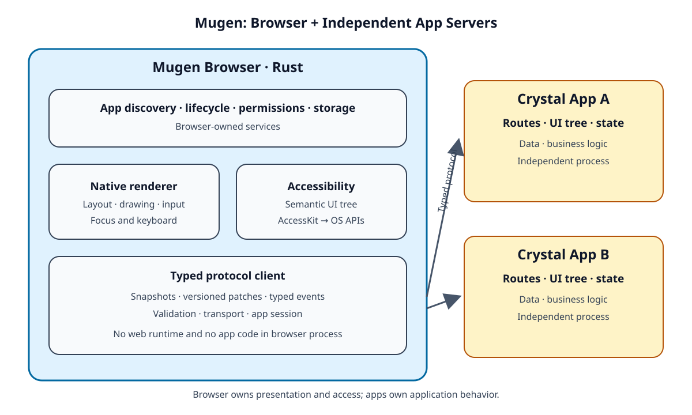
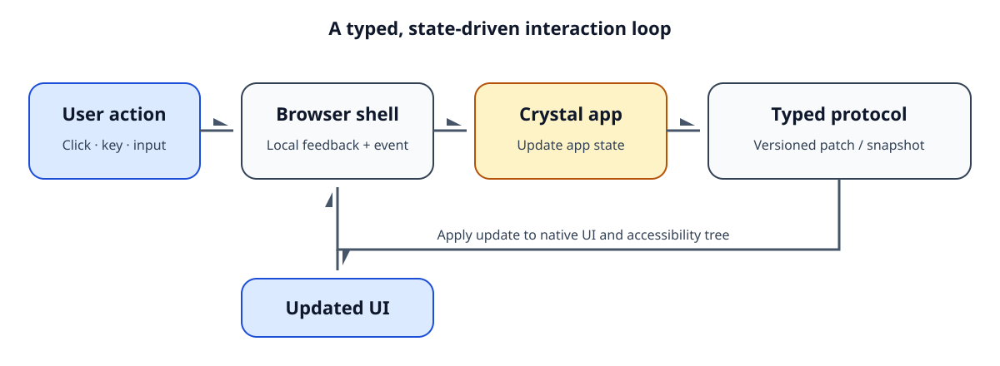

# Mugen

**A native desktop browser replacement for application experiences beyond the web stack.**

Mugen explores a different way to run applications: a Rust desktop shell renders native UI, while independent Crystal application servers own application behavior. A typed protocol connects the two.

No HTML, CSS, JavaScript, WebView, or embedded app runtime.

## Why Mugen?

- **Native UI:** rendering, layout, input, and accessibility live in the browser.
- **Independent apps:** each app runs as a separate process with its own lifecycle and boundaries.
- **Crystal backend:** apps use Crystal for routes, state, data, and business logic.
- **Typed protocol:** UI snapshots, updates, and interaction events are explicit and validated.
- **Accessibility-first:** semantic UI and keyboard interaction are core requirements.

## Architecture



The browser owns discovery, app lifecycle, permissions, storage, presentation, input, and accessibility. App servers own routes, UI state, data, and business logic. The browser and app communicate through the protocol—not shared code or a web runtime.

## Interaction flow



User input is handled locally for immediate feedback, then sent as a typed event. The app updates its state and returns a versioned patch; the browser applies it to the native UI and accessibility tree.

## Project status

| Component | Status |
| --- | --- |
| Rust workspace and desktop shell | Initial implementation |
| Typed protocol v1 and validation | Draft implemented |
| Layout and renderer | Groundwork |
| WebSocket app connection | Not implemented |
| Live native UI rendering | Not implemented |
| Crystal SDK | Specification only |
| Native accessibility bridge | Specification only |

This is an early-stage experiment; the table reflects the current implementation, not a promise of completeness.

## Repository

```
mugen/
├── crates/
│   ├── shell/       # Desktop shell and app lifecycle groundwork
│   ├── renderer/    # Native rendering groundwork
│   ├── layout/     # Typed layout groundwork
│   └── protocol/   # Protocol types and validation
├── docs/
│   ├── images/     # Architecture diagrams
│   ├── protocol-v1.md
│   ├── interaction-model.md
│   └── crystal-sdk.md
├── Cargo.toml
└── README.md
```

## Development

Run from the repository root:

```sh
cargo test -p mugen-protocol
cargo fmt --check
cargo clippy --workspace -- -D warnings
```

## Design constraints

Mugen is not a web browser with a different skin. It does not embed a web engine, execute web technologies, navigate arbitrary URLs, or load app code into the browser process. Accessibility is release-blocking and follows WAI-ARIA/APG semantics, mapped to native platform accessibility APIs.

See [AGENTS.md](AGENTS.md) for the architectural contract and [docs](docs/) for protocol and interaction details.

---

Mugen is experimental. The goal is to explore a simpler, safer, more accessible way to build desktop application experiences.
